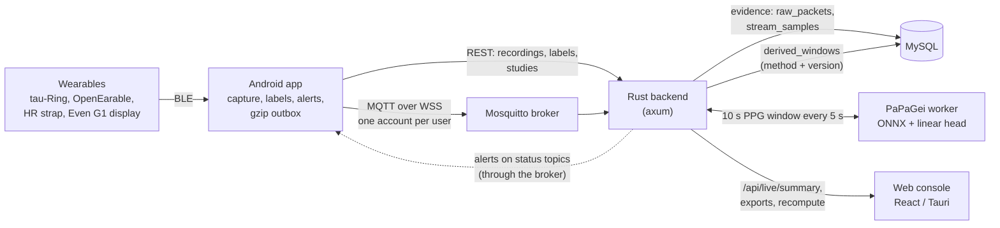

# Living Dataset for Multi-Wearable Research

An open-source system for collecting data from several wearables at once, keeping it
trustworthy, and growing it into a **living dataset**: raw evidence is kept exactly as
received, with every clock, and every derived result (windows, heart rate, model output) is
stored apart from it, versioned, and rebuildable from it.

It was built for the UNSW Thesis C project *A Living Dataset Architecture for Reproducible
Multi-Wearable Research* (Caspar Khoo, supervised by Prof. Flora Salim). It is designed so
that another research group can run its own instance and build on it.



Evidence (raw packets and parsed samples) and derived results (windows, heart rate, model
output) live in separate tables and are never mixed; see [docs/ARCHITECTURE.md](docs/ARCHITECTURE.md).

## What it does

- **Capture** from open wearables over Bluetooth (τ-Ring, OpenEarable 2.0, any standard
  heart-rate strap; Even G1 glasses as a display). A participant signs in, joins a study and records with one tap; devices
  reconnect on their own.
- **Keep the evidence.** Every packet is stored as received, with the device, phone and
  server time side by side, so timing problems are measured rather than assumed away.
- **Analyse live.** A rule-based Live Analysis Engine reports signal quality, faults (ring
  not worn, stalled stream, packet loss) and heart rate within seconds; the PaPaGei PPG
  foundation model runs live on the same data.
- **Store derived results apart**, keyed by method, version and a fingerprint of the
  evidence, so any result can be recomputed and checked.
- **Run studies**: per-participant accounts and broker isolation, study roles, consent
  before recording, withdrawal, audited erasure, retention dates, nightly backups.
- **Export and score**: dataset exports with checksums, and scripts that score any method
  against a reference device (Bland–Altman, MAE, coverage, best-constant baseline).

## Documentation

Start here if you are a developer working on the code:

| If you want to… | Read |
|---|---|
| Install the toolchains and run or test each component | [docs/DEVELOPER_SETUP.md](docs/DEVELOPER_SETUP.md) |
| Understand the data flow and the design | [docs/ARCHITECTURE.md](docs/ARCHITECTURE.md) |
| Find which tests exist, run them, and see what CI runs | [docs/TESTING.md](docs/TESTING.md) |
| Add a Bluetooth (GATT) wearable | [docs/ADDING_A_DEVICE.md](docs/ADDING_A_DEVICE.md) and [AGENTS.md](AGENTS.md) |
| Add or change a model, head, live method or schema | [docs/EXTENDING.md](docs/EXTENDING.md) |
| Train and register a new PaPaGei head | [docs/ADDING_A_MODEL_HEAD.md](docs/ADDING_A_MODEL_HEAD.md) |
| Fix something that has gone wrong | [docs/TROUBLESHOOTING.md](docs/TROUBLESHOOTING.md) |
| Send a change | [CONTRIBUTING.md](CONTRIBUTING.md) |

For people running or using an instance:

| If you want to… | Read |
|---|---|
| Host it yourself, locally or on a server: one script | [docs/SELF_HOSTING.md](docs/SELF_HOSTING.md) |
| Details for the local Docker mode | [docs/LOCAL_HOSTING.md](docs/LOCAL_HOSTING.md) |
| Update or roll back a running server | [docs/DEPLOY_RUNBOOK.md](docs/DEPLOY_RUNBOOK.md) |
| Check what remains before a release | [docs/RELEASE_CHECKLIST.md](docs/RELEASE_CHECKLIST.md) |
| Run a study on an instance | [docs/STUDY_MANAGER_GUIDE.md](docs/STUDY_MANAGER_GUIDE.md) |
| Take part in a study | [docs/PARTICIPANT_GUIDE.md](docs/PARTICIPANT_GUIDE.md) |
| Get the Android app onto phones | [docs/APK_DISTRIBUTION.md](docs/APK_DISTRIBUTION.md) |
| Export, recompute and score data; reproduce the thesis results | [docs/RESEARCHER_DATA_GUIDE.md](docs/RESEARCHER_DATA_GUIDE.md) |

References: [docs/reference/](docs/reference/) holds the schema
([LIVING_DATASET_SCHEMA.md](docs/reference/LIVING_DATASET_SCHEMA.md)), the capture API
([CONTROL_API.md](docs/reference/CONTROL_API.md)), the study API
([STUDY_API.md](docs/reference/STUDY_API.md)), the model input contract
([PROCESSOR_CONTRACT.md](docs/reference/PROCESSOR_CONTRACT.md)) and app distribution
([APP_DISTRIBUTION.md](docs/reference/APP_DISTRIBUTION.md)). Security reports: [SECURITY.md](SECURITY.md).

## Repository layout

| Path | Contents |
|---|---|
| `android-application/` | Android capture app (Java); Gradle project in `android/` |
| `backend/` | Rust backend (`src/`): ingest, live analysis (`live.rs`), derived results (`derived.rs`), studies, erasure, export, recompute; `schema.sql`, `migrations/`, processor manifests and contracts |
| `frontend/` | Web console (React + TypeScript + Vite; also packaged with Tauri) |
| `ml-inference-server/` | PaPaGei worker (Flask, ONNX Runtime or PyTorch) and the trained heads in `heads/` |
| `deployment/local/` | The whole stack on one computer, started by `scripts/deploy.sh local` |
| `deployment/cloud/` | Docker Compose stack for a server: MySQL, Mosquitto, backend, PaPaGei, Caddy |
| `scripts/` | `deploy.sh` (host it: local or VM), local stack control, deploy, backups, broker accounts, head training, scoring, fault injection, tests |
| `docs/` | Guides by role, and `docs/reference/` for the schema and APIs |
| `.github/workflows/` | Continuous integration |

## Quick start (everything on your computer)

You need Docker running, bash (Git Bash on Windows) and a free [Supabase](https://supabase.com)
project for sign-in (Project Settings, API: the project URL and the *publishable* key).

```bash
git clone https://github.com/casparkhoo/wearable-living-dataset.git
cd wearable-living-dataset
scripts/deploy.sh local --supabase-url https://<ref>.supabase.co --supabase-key sb_publishable_...
```

It generates passwords, builds and starts the stack (first run 5 to 15 minutes) and prints the
addresses. Open http://localhost:8088, sign up, then make yourself administrator:

```bash
scripts/local.sh admin you@example.org
```

(If a script reports "permission denied", run it as `bash scripts/deploy.sh ...`.) For a server:
`scripts/deploy.sh vm ubuntu@<server-ip> --supabase-url ...`, see
[docs/SELF_HOSTING.md](docs/SELF_HOSTING.md) (use a server with at least 2 GB of RAM). Phone setup,
tunnels and backups are in [docs/LOCAL_HOSTING.md](docs/LOCAL_HOSTING.md). To work on the code rather
than run the stack, see [docs/DEVELOPER_SETUP.md](docs/DEVELOPER_SETUP.md).

Quick checks that need no database or device:

```bash
cd backend && cargo test                 # Rust unit tests
cd frontend && npm ci && npm run build   # type-check and build the console
python scripts/test_processor_contract.py
```

## Citing

If you use this system, please cite the thesis; see [CITATION.cff](CITATION.cff).

## Licence

MIT, see [LICENSE](LICENSE). PaPaGei (model code and weights) is © Nokia Bell Labs under
the BSD 3-Clause licence; see [THIRD_PARTY_NOTICES.md](THIRD_PARTY_NOTICES.md).
