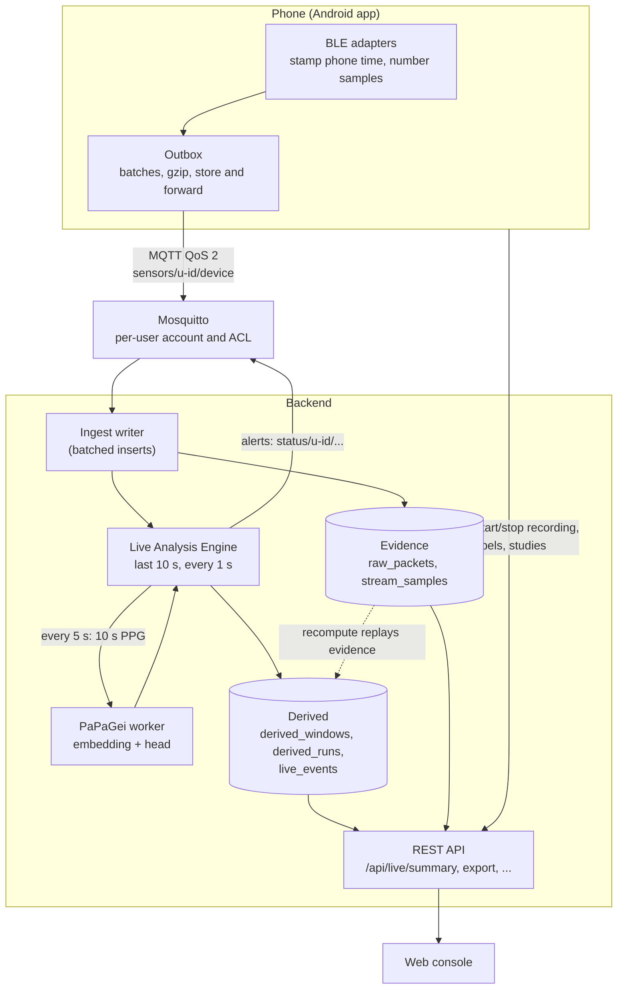

# Architecture

A short map of how the system fits together and why. The thesis (see
[CITATION.cff](../CITATION.cff)) gives the full reasoning and evaluation.

## Components

| Component | Technology | Responsibility |
|---|---|---|
| Android app | Java | Owns Bluetooth and the recording state: connects wearables, starts and stops recordings, takes one-tap labels, shows live alerts, drives Even G1 glasses |
| Broker | Mosquitto (MQTT over WSS through Caddy) | Transport. Every participant has their own account, limited by ACL to their own topics |
| Backend | Rust (axum, sqlx) | Stores evidence, runs the Live Analysis Engine, calls model workers, writes derived windows, serves studies, erasure, export and recompute |
| Database | MySQL 8 | Evidence, identity and studies, live events, derived windows, erasure log |
| Model worker | Python (Flask), ONNX Runtime | PaPaGei-S embeddings plus a task head, about 2 ms per window on one CPU |
| Web console | React + TypeScript (Vercel or Tauri) | Live view, history, studies and membership, export |
| Identity | Supabase Auth | Proves who someone is. Roles and membership are read from our own database on every request |

## Data flow

1. The participant signs in on the phone. The app fetches their own broker credential
   from the backend (`GET /api/me/mqtt-credentials`; the password is derived from a server
   secret and the user id, never stored).
2. *Record* creates an experiment and one device recording per wearable over REST; the
   server refuses unless the participant has consented to the chosen study.
3. Each Bluetooth notification is stamped with the phone's time and queued in the app's
   **outbox**. Messages go to `sensors/u<id>/<device>` as soon as the broker connection allows.
   If a publish fails the message goes back to the front of the queue, so a dropout delays
   samples instead of losing them (the outbox is bounded at 64 MB; beyond that the oldest are
   dropped and counted). A backlog is merged into larger batches (up to about 3,000 samples when
   gzip is on), and batches are gzip-compressed when the backend's `/health` says it accepts them
   (`batch_ingest`, `gzip_ingest`). The backend recognises gzip by its magic bytes and caps the
   decompressed size at 32 MB. Control traffic (recordings, labels, studies) is plain REST;
   samples travel over MQTT only.
4. The backend writes each packet as received to `raw_packets`, then the parsed samples to
   `stream_samples`, with the server's time beside the phone's and the device's. Writes go
   through a queue and are inserted in batches.

   **Packets that arrive out of step with the recording.** The broker acknowledges a message
   before the backend reads it, so a packet the backend refuses is lost for good. On 19 Nov
   about 12,650 payloads were refused for having no active recording: the phone publishes right
   after it asks to record, and flushes its outbox right after it stops. The writer
   (`backend/src/pending.rs`, wired in `run_ingest_writer`) now handles both, per packet:
   - *Recording active:* stored as before (counter `accepted`).
   - *Recording ended within the last 30 s, none active:* stored in the recording that just
     ended (`accepted_after_stop`). It is not fed to live analysis again. Nothing in the
     evidence tables marks it; its `received_timestamp_ms` is the original arrival time, which
     is later than the recording's `ended_at_ms`. If a new recording for the same device
     is already active, the packet goes to the new one.
   - *No recording yet:* held in memory (`held`) for up to 60 s, then stored in the recording
     when one becomes active for the same device (`replayed`), before any newer packet, in
     arrival order, with the original arrival time. After 60 s it is dropped
     (`dropped_no_session`), logged at most once per 10 s with the count.
   - *Isolation:* the user is the `u<id>` segment of the topic, which the broker ACL ties to the
     publishing account. A held or late packet is only stored in a recording whose owner is that
     user; otherwise it stays held until it expires. A topic without `u<id>` is keyed as the
     unattributed owner and matches any recording of the device, as before.
   - *Limits (memory):* at most 20,000 packets and 8 MiB per user, 24 MiB over all users; the
     oldest packet of the same user is dropped first (`dropped_buffer_full`), so one user cannot
     push out another's. The ended-recording memory holds one small entry per device (at most
     256). `rejected_other` counts the remaining refusals (a topic owner that does not match the
     recording, a database error); their log line is also limited to one per 10 s.

   `GET /health` has an `ingest` object with these counters (packets, not messages), plus
   `pending_packets` and `pending_bytes` now. Known limits: held packets are in memory only, so a
   backend restart within the 60 s loses them (counted nowhere); a recording restarted on the same
   device within 30 s of a stop receives packets that arrive before the new recording exists as
   the end of the old one; the grace times are constants, not settings.
5. Every second the Live Analysis Engine (`backend/src/live.rs`) looks at the last 10 s of each
   recording: stalls, loss, flat signal, saturation, motion, heart rate and a signal-quality
   score. Alerts go back on `status/u<id>/...` to the phone and glasses, and the console reads
   the same state from `GET /api/live/summary`. Every fifth tick a `live_ppg` row is written to
   `derived_windows`.
6. Every 5 s the backend sends the newest 10 s of the PPG channel the live algorithm chose to
   the PaPaGei worker (`POST /infer` with a `head_id`). The worker prepares the window itself and
   returns the heart rate from the head; the backend stores it as a derived window with method
   `papagei_s+<head id>`.
7. Researchers export experiments (zip with manifest and checksums) and can recompute any
   recording's derived data from its evidence.

## Evidence and derived results

The two kinds of data are kept apart on purpose.

| | Evidence | Derived |
|---|---|---|
| Tables | `raw_packets`, `stream_samples` (with `experiments`, `sessions`, `annotations`) | `derived_windows`, `derived_runs`, `live_events` |
| Written | Once, at ingest, as received | By live analysis while recording, and by recompute |
| Changed afterwards | Never (only a logged erasure of a participant's data removes it) | A newer run adds rows; old rows stay |
| Identified by | Recording, device, phone/server/device clocks | Method id, method version, and the run that made it |

A parser or algorithm bug is therefore fixable: fix it, bump the version, recompute. Nothing in
the evidence tables is rewritten to match a newer algorithm.

### Recipe versions

Each derived method has an id and a version.

- The rule-based live algorithm is method `live_ppg`, version `live::RECIPE_VERSION` (currently
  `live-ppg/1.3.0`, in `backend/src/live.rs`). **Bump it whenever the algorithm's output can
  change.** Windows already stored keep the version that made them.
- A PaPaGei head result is method `papagei_s+<head_id>`, with the head manifest's `head_version`
  as its version (`unversioned` if the manifest has none).
- `wearable-backend recompute <recording id>` (or `POST /api/evidence-sessions/:id/recompute`)
  replays a stored recording through a fresh engine exactly as ingest fed it, and writes rows
  tagged with a new `derived_runs` row. The run records how many evidence rows it read and their
  SHA-256 (`evidence_rows`, `evidence_sha256`), so two runs can be shown to have read the same
  input. `--no-model` skips the worker.
- The scorer (`scripts/score_methods.py`) keeps the newest run per method, so a change never
  silently rewrites history, and versions can be scored side by side.

### Quality alerts in the live analysis

Fit and signal alerts are judged per second over the newest 10 s window, then held back so that one
bad window never interrupts anyone:

- `ppg_no_pulse` (no pulse at all: off the finger or out of the ear): raised after 20 consecutive
  windows (30 for earbuds), cleared after 15, and only while the wearer is still.
- `ppg_quality_low` (a weak pulse, "adjust the fit") counts instead of needing an unbroken run. It
  looks at the last 60 ticks and raises when either **40 were poor while the wearer was still**
  (since 1.2.0) or **57 were poor whether or not the wearer moved** (new in 1.3.0). It clears when 20
  or fewer of the 60 were poor, counting moving windows too, so an alert can last longer than under
  1.2.0 and two episodes can merge.
- Movement suppression stays: a single poor window while moving raises nothing, because motion
  corrupts the pulse for a moment. What 1.3.0 adds is that a pulse missing for nearly all of a
  minute is a fit problem even when the hand moves (handling a loose ring is itself movement).
  Real data showed that fewer than 57 of 60 cannot be separated from ordinary hand use: with a bar
  of 45 the same recordings raised an alert in almost every session, including while the wearer
  sat. Even at 57, the replayed recordings gained a handful of alerts (see
  `outputs/fault_injection_1_3_0/results.md`); treat that rate as the cost of the rule.
- Old rows keep their version: `live-ppg/1.2.0` rows were made without the moving condition and are
  not rewritten.

### Which heart rate a participant sees

Both the rule-based and the model heart rate are always stored. Which one is *shown* on the
phone, glasses and console is a display choice, made in `analyse_session` in
`backend/src/live.rs` from two settings:

- `LIVE_HR_SOURCE`: `papagei` (the default) or `rules`. With `papagei`, the display uses the
  model when it has a fresh estimate and the rules otherwise. It is forced to `rules` when
  `ML_INFERENCE_ENABLED` is false.
- `ML_LIVE_HEAD_ID`: which head in `ml-inference-server/heads/` the worker applies to live windows
  (`hr_ring_stretch_v2` in the compose files and `.env.example` files). Unset, no model runs live.

The selection, in order:

1. If the rules engine finds no pulse under the sensor (`hr_reason` is `no_pulse`), no heart rate
   is shown from either method.
2. Otherwise, if `LIVE_HR_SOURCE` is `papagei` and the newest model estimate is at most 15 s
   old (`MODEL_STALE_MS`), the display shows the **median of the model's last three estimates**
   (about 15 s), because one window's estimate is noisy.
3. Otherwise the rules' estimate is shown.

Each summary says which one it used (`hr_source` is `papagei` or `rules`), and the trend line
(`display_hr_history`) follows the same choice. This is display only: what recompute rebuilds and
what the scorer compares are the stored `live_ppg` and `papagei_s+...` windows.

### Hold last good

When a wearable's stream stalls (a short Bluetooth or network drop) the backend stops reporting
its pulse, waveform and movement, and the model estimate expires after 15 s. Rather than blank
the screen for a drop of a few seconds, the clients keep the last good reading:

- The console (`holdLastGood` in `frontend/src/hooks/useBackend.ts`) keeps, per recording, the last
  `ppg`, `movement`, `model` and trace arrays it received, and a failed poll keeps the previous
  summary. The values are frozen, not extrapolated, and the tile's status says Delayed or Offline.
- The Android app does the same in `MainActivity.holdLastGood`, and the glasses show the held
  values.

The backend holds nothing: its own summary is always the current state, and the stored derived
windows contain only what was computed.

## Principles

- **Raw first.** Packets are stored before parsing and never edited. A parser bug can be
  fixed and the samples rebuilt; a lost packet cannot.
- **Keep every clock.** Device, phone and server times are stored side by side. Labels are
  matched on the phone's clock, because that is the clock the participant tapped on. A
  2.7 s phone–server offset found during development would otherwise mislabel data.
- **Derived data is labelled and rebuildable.** Every derived window names its method and
  version; every run records a fingerprint of the evidence it read.
- **Models are consumers, not dependencies.** A model declares the input it needs and
  prepares it itself; the dataset does not change shape for it.
- **Authorisation lives with the data.** Roles, membership and consent are checked on our
  server; the identity provider cannot grant access.
- **Small enough to self-host.** The whole stack runs on one computer in Docker (`scripts/local.sh up`) or on a small cloud machine.

## Where to read more

| Topic | Document |
|---|---|
| Schema and timing policy | [reference/LIVING_DATASET_SCHEMA.md](reference/LIVING_DATASET_SCHEMA.md) |
| Capture and control API | [reference/CONTROL_API.md](reference/CONTROL_API.md) |
| Studies, roles, consent, erasure API | [reference/STUDY_API.md](reference/STUDY_API.md) |
| Model input contract | [reference/PROCESSOR_CONTRACT.md](reference/PROCESSOR_CONTRACT.md) |
| Adding a Bluetooth wearable | [ADDING_A_DEVICE.md](ADDING_A_DEVICE.md) |
| Adding a model head | [ADDING_A_MODEL_HEAD.md](ADDING_A_MODEL_HEAD.md) |
| Running and testing each part | [DEVELOPER_SETUP.md](DEVELOPER_SETUP.md), [TESTING.md](TESTING.md) |
| When something breaks | [TROUBLESHOOTING.md](TROUBLESHOOTING.md) |
